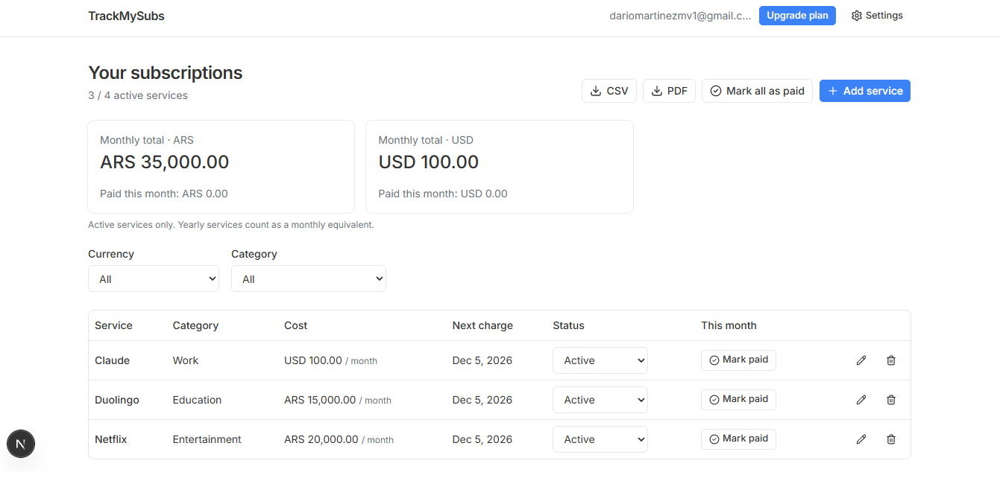
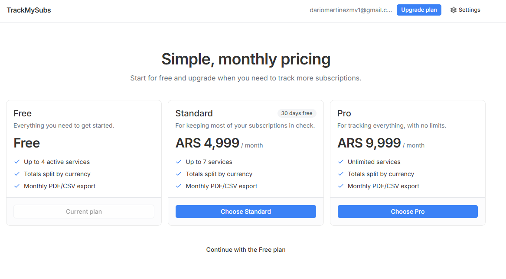
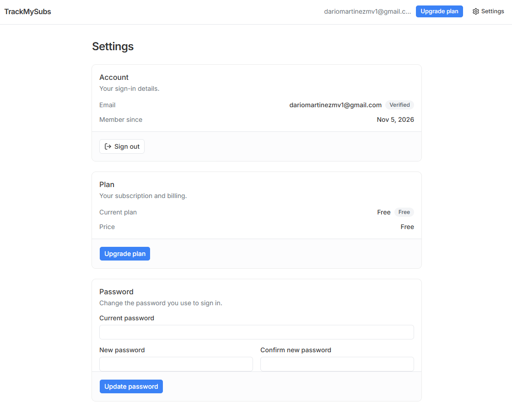
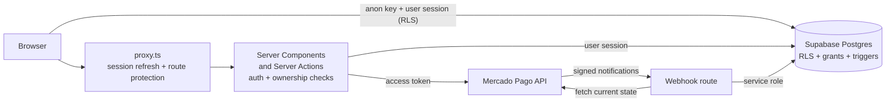
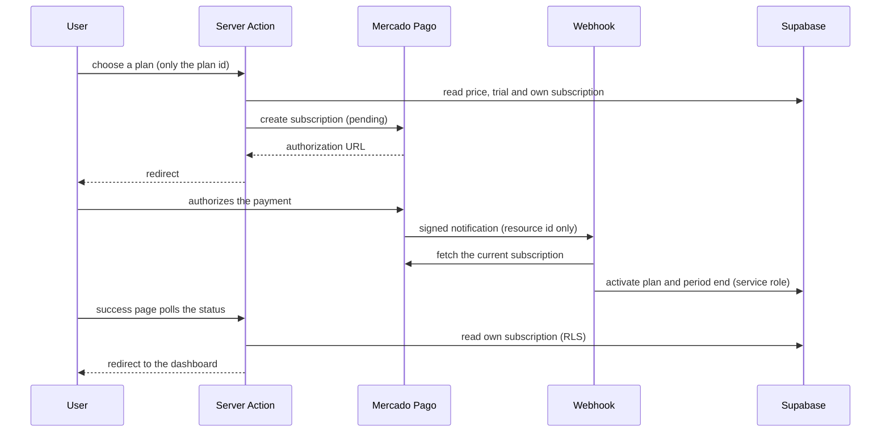
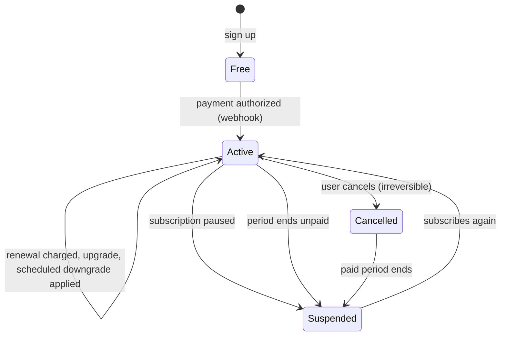
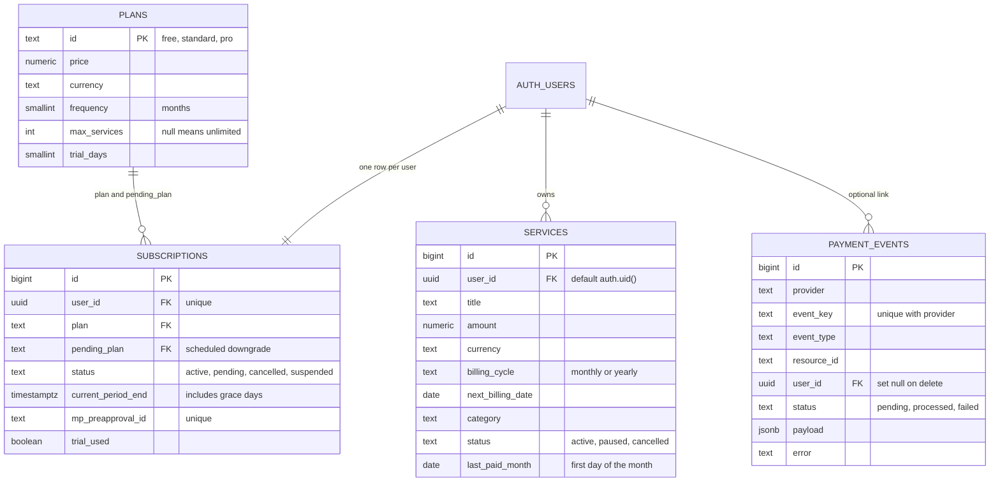

# TrackMySubs

**A personal dashboard to track every subscription you pay for (Netflix, Spotify, YouTube and more), with monthly totals per currency, upcoming charge dates and exports, backed by real recurring billing through Mercado Pago.**

Most people lose track of what they pay for each month, often in more than one currency. TrackMySubs gives them one place to register their services, see what they spend, mark what is already paid this month and download a report. The app itself is sold as a monthly subscription with three plans, and everything about it (who may do what, how much, until when) is decided and enforced on the server and in the database, not only in the interface.


---






## At a glance

| | |
|---|---|
| **What it is** | A subscription tracker as a SaaS: users register the services they pay for and see totals, charge dates and reports; the product itself is billed monthly with three plans. |
| **Who it is for** | Anyone who wants to know what their subscriptions cost per month, in each currency, without a spreadsheet. |
| **Highlights** | Real recurring payments (Mercado Pago subscriptions), free trial once per user, prorated upgrades, scheduled downgrades, irreversible cancellation, signed and idempotent webhooks, plan limits enforced by the database, CSV and PDF reports. |
| **Stack** | Next.js (App Router) · TypeScript · Tailwind v4 · shadcn/ui · Supabase (Auth, Postgres, RLS) · Mercado Pago SDK |

## Table of contents

1. [Why it matters](#why-it-matters)
2. [Features](#features)
3. [User experience](#user-experience)
4. [Tech stack](#tech-stack)
5. [Architecture](#architecture)
6. [Security](#security)
7. [Technical documentation](#technical-documentation)
8. [Project structure](#project-structure)
9. [Getting started](#getting-started)
10. [Manual setup in Mercado Pago](#manual-setup-in-mercado-pago)
11. [Manual setup in Supabase](#manual-setup-in-supabase)
12. [Testing](#testing)
13. [Production checklist](#production-checklist)
14. [Known limitations](#known-limitations)

---

## Why it matters

Small recurring charges are easy to forget and hard to add up, especially when they come in different currencies. TrackMySubs solves that, and it is also built as a complete, production-minded paid product:

- **Clear:** one dashboard with the monthly total split by currency (ARS, USD, EUR...), each service's next charge date and what has already been paid this month.
- **Practical:** filter by currency or category, pause or cancel services, mark everything as paid in one click and download the month as CSV or PDF.
- **Fair billing:** three monthly plans, a free trial the first time only, upgrades that charge just the remaining part of the month, downgrades that take effect next period, and cancellation that keeps access until the paid period ends.
- **Trustworthy:** prices, limits and permissions never come from the browser. The server verifies every payment with Mercado Pago, and the database refuses anything the plan does not allow.
- **Isolated:** each user's data is invisible to every other user, at the database level.

## Features

**Plans**

| Plan | Price | Active services | Extras |
|---|---|---|---|
| Free | ARS 0 | up to 4 | CSV / PDF export |
| Standard | ARS 4,999 / month | up to 7 | **30 days free, first time only**; CSV / PDF export |
| Pro | ARS 9,999 / month | unlimited | CSV / PDF export |

Prices, limits and trial length live in the database (`plans` table), so changing them does not require touching the application code.

**Accounts**
- Sign up and sign in with email and password (Supabase Auth), with email verification.
- Forgot password and reset password. The reset page requires the recovery session from the email link.
- Change password from Settings (asks for the current password first).
- The first sign-in after verifying lands on the plans page; later sign-ins go to the dashboard. Signed-in users are redirected away from the login pages.

**Dashboard**
- Add a service: name, cost, currency, billing cycle (monthly or yearly), charge date and category.
- Edit, delete, and change a service's status: active, paused or cancelled.
- Mark a service as paid for the month, or mark all as paid. It resets by itself every month.
- Totals per currency for active services (yearly services count as a monthly equivalent) plus how much is already paid.
- Next charge date for each service, calculated from the billing day.
- Filters by currency and category; usage counter against the plan limit (for example `3 / 4 active services`).
- Download the full month as **CSV** or **PDF** (with totals per currency).
- Notices: "Your plan ends soon" (cancelled plan, 7 days or less) and "We haven't received your latest payment" (renewal not confirmed yet).
- Suspended accounts see a renewal screen instead of the dashboard; their data stays safe.

**Billing and plan management**
- Public plans page that adapts to who is looking at it (visitor, free, paid, cancelled, suspended).
- Checkout summary, then redirect to Mercado Pago to authorize the recurring payment.
- Status pages while the payment is confirmed: success (with automatic polling), pending and error.
- **Upgrade (Standard to Pro):** the user pays only the price difference for the rest of the current period, through a one-time Mercado Pago payment. Pro starts as soon as the payment is approved and the next charge is the Pro price.
- **Downgrade (Pro to Standard):** scheduled. The user keeps Pro until the period already paid ends; the next charge is the Standard price.
- **Cancel:** irreversible. The user keeps the current plan until the paid period ends, with no refund, and can subscribe again after it ends. Until then no plan change or new purchase is possible.
- **Renew:** after the plan ends (suspended account), the user subscribes again from Settings.

**Settings**
- Account details, plan status, price, next payment or access end date, and sign out.

## User experience

**New user**
1. Signs up, verifies the email and lands on **Plans**.
2. Picks *Continue with the Free plan* or *Choose Standard / Pro*.
3. Paying sends the user to Mercado Pago; coming back shows "Confirming your payment" and, as soon as the server confirms it, the dashboard opens.

**Free user:** tracks up to 4 active services. Adding a fifth shows the limit message with an upgrade link; the database refuses it as well.

**Paid user**
1. Adds services, marks them paid, filters, exports the month.
2. In **Settings** can upgrade, schedule a downgrade or cancel.

**Cancelled user:** keeps everything until the end date shown in Settings and the dashboard. After that the account is suspended until a new subscription is bought.

**Edge cases handled:** double clicks and double checkouts (a duplicate subscription is cancelled automatically so the user is not billed twice); webhooks delivered twice or out of order; a payment confirmed before or after the user returns to the site; a user landing on the success page with a forged id (it only affects which screen is shown, never access); a plan that expires while the app is open (the database refuses changes).

## Tech stack

| Area | Technology |
|---|---|
| Framework | Next.js 16 (App Router, Server Components, Server Actions, `proxy.ts`), React |
| Language | TypeScript (strict) |
| Styling / UI | Tailwind CSS v4, shadcn/ui (Base UI primitives), lucide-react, react-icons, Inter / Source Serif 4 / JetBrains Mono, light theme |
| Authentication | Supabase Auth (email and password, email verification, recovery) with `@supabase/ssr` |
| Database | Supabase PostgreSQL with Row Level Security, column-level privileges and triggers |
| Payments | Mercado Pago subscriptions (PreApproval API) and Checkout Pro (one-time payment for prorated upgrades), official `mercadopago` SDK v2 |
| Reports | jsPDF and jspdf-autotable (client-side), CSV generation |
| Integration CLI | [`@dariomvg/create`](https://www.cli.dariomvg.com) (Supabase `basic-auth` and Mercado Pago `subscriptions` modules), adapted as described in [Authentication](#authentication-and-installed-modules) |

## Architecture



**Who is who:** Supabase stores users, plans, subscriptions and services, and Row Level Security applies the access rules. Next.js runs the application logic. Mercado Pago charges the user and tells the server about it through signed webhooks. The browser talks to the database directly only for the dashboard's service CRUD, where RLS, column privileges and triggers are the safety net.

**Subscribing**



**Plan lifecycle**



**Key design decisions**
- **The server is the source of truth for money.** The browser only sends a plan id. Price, currency, trial, user and email are read on the server; amounts for upgrades are calculated on the server and re-validated by the webhook.
- **Webhooks sync state, they do not trust payloads.** A notification only provides an id; the handler fetches the current resource from Mercado Pago and aligns the database with it, so replayed or out-of-order notifications are harmless.
- **Access is derived, not stored as a flag.** A function in the database computes the effective plan from the plan, status and period end, so an expired plan loses access on its own, with no cron job.
- **Business rules live in the database** (limits, suspension, immutable columns), so they hold no matter which client calls the API.
- **No third-party libraries for plan logic:** upgrades, downgrades and cancellation are explicit, small server functions with their own checks.

## Security

Defense in depth: every sensitive operation is checked at several independent levels.

| Layer | What it does |
|---|---|
| **`proxy.ts`** | Refreshes the Supabase session on every request, protects `/dashboard`, `/settings` and `/checkout`, redirects signed-in users away from the login pages and from the home page. |
| **Server guards** | Pages call `requireAuth()`; every Server Action re-checks the session, the verified email and the subscription state before acting. |
| **Server Actions** | Validate input (plan ids against a whitelist), take user, email, price and currency from the server, never from the client, and return generic errors (details go to the server log). |
| **Mercado Pago module** | The installed module's functions (cancel, change amount, read any subscription by id) are **not** exposed as Server Actions (`"use server"` would make them public endpoints). They are `server-only` and only called from our own authenticated actions, using the subscription id stored in the caller's own row. |
| **Webhook** | Verifies the `x-signature` HMAC (timing-safe), validates the resource id format, records each event for idempotency, fetches the real state from Mercado Pago and updates the database with the service role. Retryable failures return 500 so Mercado Pago redelivers; permanent ones are stored as `failed` with the reason. |
| **Row Level Security** | Every table is default-deny. Users only see and change their own rows; `payment_events` has no policy at all (service role only). |
| **Column-level privileges** | On `services`, only specific columns can be inserted or updated; `user_id`, `id` and `created_at` can never be set by a client. `subscriptions` cannot be written by clients at all. |
| **Triggers** | A user-scoped lock plus a trigger enforces the active-services limit of the plan and blocks changes on suspended accounts, so concurrent requests cannot slip past a limit. |
| **Function privileges** | All helper functions have `EXECUTE` revoked from `anon` and `authenticated` and use an empty `search_path`. |

**Other protections**
- Open-redirect protection: the `next` parameter of the login page and of the auth callback only accepts internal paths.
- Forgot password always answers the same, so it does not reveal which emails exist. Changing the password asks for the current one.
- Double checkouts: if a second subscription is authorized while one is active, the newer one is cancelled at Mercado Pago.
- A late cancellation event for an old subscription never overwrites a newer one.
- Upgrade payments are re-validated by the webhook: who, which plan, reference, currency and that the amount is within the allowed range of the price difference.
- The success page only uses the id in the URL to choose which screen to show, after Mercado Pago confirms it belongs to the signed-in user.
- CSV exports neutralize spreadsheet formulas (`=`, `+`, `-`, `@`).
- Secrets (Mercado Pago token, webhook secret, service role key) are only read on the server; the service role is used only by the webhook and the billing management actions.

**Limits and where each one is enforced**

| Limit | Default | Enforced by |
|---|---|---|
| Active services (Free / Standard / Pro) | 4 / 7 / unlimited | Database trigger, reading `plans.max_services` (the UI also shows it) |
| Service name / category length | 100 / 50 characters | Database checks |
| Service cost | `>= 0`, 2 decimals | Database check |
| Currency | 3 uppercase letters | Database check |
| Free trial | 30 days, once per user | Server (`trial_used`) |
| Grace after the next payment date | 3 days | `BILLING_GRACE_DAYS` in `config.tsx` |
| Minimum prorated upgrade charge | ARS 50 | `MIN_PRORATED_CHARGE` in `config.tsx` |

## Technical documentation

### Access rules

The database function `public.effective_plan(user_id)` decides what rules apply to a user:

| Subscription row | Effective plan |
|---|---|
| `plan = free` | `free` |
| `status = pending` (checkout not confirmed yet) | `free` |
| Paid plan, `status` active or cancelled, `current_period_end` in the future | that plan |
| Anything else (period over, subscription paused) | **none: account suspended** |

A suspended account cannot create or change services (the trigger raises `account_suspended`). The dashboard shows a renewal screen.

`current_period_end` is the next payment date from Mercado Pago **plus** the grace days, so a charge that is a few hours late does not lock the user out.

### Database (`supabase/supabase.sql`)



**Privileges and policies**

| Table | anon | authenticated | service role (server only) |
|---|---|---|---|
| `plans` | SELECT | SELECT | all |
| `subscriptions` | nothing | SELECT own row | all (webhook, billing actions) |
| `services` | nothing | SELECT and DELETE own rows; INSERT / UPDATE only the columns `title`, `amount`, `currency`, `billing_cycle`, `next_billing_date`, `category`, `status`, `last_paid_month` | all |
| `payment_events` | nothing | nothing | all |

**Functions and triggers**

| Name | Purpose |
|---|---|
| `set_updated_at` (trigger on `subscriptions`) | Keeps `updated_at` current |
| `handle_new_user` (trigger on `auth.users`) | Creates the free subscription row for every new user |
| `effective_plan(user_id)` | Computes the plan whose rules apply right now, or null when suspended |
| `enforce_service_limits` (trigger on `services`) | Blocks suspended accounts and enforces the active-services limit under a per-user advisory lock |

### Billing

**Subscribing.** The server creates a Mercado Pago subscription **without an associated plan** and with status `pending`; Mercado Pago returns a URL where the user authorizes it. (A subscription with a plan requires a card token and is created already authorized, so it cannot be used with a redirect.) The trial is a creation-time `free_trial`, added only when `plans.trial_days > 0` and the user has not used it. The subscription's `external_reference` is the user id.

**Webhook (`/api/webhooks/mercadopago-subscriptions`).**

| Notification | What happens |
|---|---|
| `subscription_preapproval`, authorized | The amount is matched to a paid plan; the row becomes `active` with the plan, `mp_preapproval_id` and `current_period_end` (next payment date + grace days); `trial_used` is set when the subscription has a trial. A second active subscription is cancelled. |
| `subscription_preapproval`, paused | The row becomes `suspended` (only if it is the current subscription). |
| `subscription_preapproval`, cancelled | The row becomes `cancelled`, keeping access until `current_period_end` (only if it is the current subscription). |
| `subscription_authorized_payment`, processed | The period end moves forward (renewal). If the amount is lower than the current plan, the scheduled downgrade is applied only when the new period actually starts. |
| `payment`, approved, with `plan_upgrade` metadata | The upgrade is validated, the recurring amount is raised at Mercado Pago and the plan becomes the new one. |

Each notification is stored in `payment_events` by `(provider, event_key)`. An already processed event is acknowledged and skipped; a failed one is processed again on redelivery.

**Upgrade price.** `difference = new price - current price`, prorated by the fraction of the paid period that is left, never below `MIN_PRORATED_CHARGE` and never above the full difference. It is charged as a one-time Checkout Pro payment. The plan changes only after the webhook confirms the payment.

**Downgrade.** The recurring amount is lowered at Mercado Pago and `pending_plan` records the change. The user keeps the higher plan until the next period starts; the webhook then switches the plan and clears `pending_plan`. If the database write fails, the webhook also derives the pending downgrade from the lower amount, so it converges anyway.

**Cancel.** Cancels the subscription at Mercado Pago (terminal there) and marks the row `cancelled`. There is no way back: access lasts until `current_period_end`, and a new subscription can be bought after it ends.

### Server Actions

| Action | What it checks |
|---|---|
| `startCheckout(planId)` | Signed in, verified email, plan whitelist, price and trial from the database, no paid plan with time left |
| `getCheckoutStatus(targetPlan?)` | Signed in; reports whether the webhook has applied the purchase or upgrade |
| `startUpgrade(planId)` | Active paid plan, real upgrade, prorated amount computed on the server, subscription id from the caller's own row |
| `scheduleDowngrade(planId)` | Active paid plan, real downgrade, nothing already scheduled |
| `cancelPlan()` | Active paid plan; subscription id from the caller's own row |
| Auth actions (sign up, sign in, sign out, forgot / reset password, resend verification) | Provided by the installed Supabase module; messages are mapped to English from error codes |

The dashboard's service CRUD does not use Server Actions: it runs from the browser with the user's session, and the database enforces ownership, columns, limits and suspension.

### Routes

| Route | Access | Purpose |
|---|---|---|
| `/` | Public (signed-in users go to `/dashboard`) | Home: hero and links |
| `/login`, `/signup`, `/forgot-password` | Visitors only | Authentication |
| `/reset-password` | Recovery session from the email link | Set a new password |
| `/api/auth/callback` | Browser-navigated | Email verification and recovery code exchange |
| `/planes` | Public | Plans; buttons adapt to the user |
| `/checkout?plan=` | Signed in | Order summary, then Mercado Pago |
| `/checkout/success`, `/checkout/pending`, `/checkout/error` | Signed in | Payment status |
| `/checkout/upgrade?plan=` | Signed in | Waits for the upgrade payment to be confirmed |
| `/dashboard` | Signed in | Services, totals, filters, exports |
| `/settings` | Signed in | Account, plan management, password |
| `/api/webhooks/mercadopago-subscriptions` | Mercado Pago (signature required) | Webhook |

### Authentication and installed modules

Authentication and the Mercado Pago integration start from the modules generated by the [`@dariomvg/create`](https://www.cli.dariomvg.com) CLI (`basic-auth` for Supabase and `subscriptions` for Mercado Pago). The CLI only copies code; the application is built on top of it. Adjustments made to the installed files:

- `basic-auth/service.ts` and `client.ts`: redirects point to `/api/auth/callback`; verification links go through `?next=/planes`, recovery links through `?next=/reset-password`.
- `app/api/auth/callback/route.ts`: the `next` parameter is validated against open redirects.
- `proxy.ts`: written for Supabase; also redirects the home page for signed-in users.
- `subscriptions/actions.ts`: no longer `"use server"` (see [Security](#security)).
- `subscriptions/service.ts` and `types.ts`: create subscriptions without a plan, support `free_trial`, expose `next_payment_date`; request bodies are cast to the SDK types where the SDK does not declare fields the REST API accepts.
- `app/api/webhooks/mercadopago-subscriptions/route.ts`: rewritten to be idempotent and to sync state (see [Billing](#billing)).
- The module's own reset-password page is not used; the app has its own.

### Configuration (`src/lib/config.tsx`)

One file holds all copy (English), routes, plan display content and the constants of the business rules: `PASSWORD_MIN_LENGTH`, `BILLING_GRACE_DAYS`, `EXPIRY_WARNING_DAYS`, `MIN_PRORATED_CHARGE`, `PLAN_RANK`, default categories and currencies. Prices, service limits and trial length are **not** here: they live in the `plans` table. If you change a limit in the database, update the matching feature text in `PLANS` in `config.tsx`.

### Environment variables

| Variable | Purpose |
|---|---|
| `NEXT_PUBLIC_SITE_URL` | Public base URL (auth redirects, Mercado Pago return URLs). Must be `https` and public when testing payments |
| `NEXT_PUBLIC_SUPABASE_URL`, `NEXT_PUBLIC_SUPABASE_ANON_KEY` | Supabase public URL and publishable key |
| `SUPABASE_SERVICE_ROLE_KEY` | Supabase secret key. **Server only.** Used by the webhook and the billing management actions |
| `MERCADOPAGO_ACCESS_TOKEN` | Mercado Pago access token. **Server only** |
| `MERCADOPAGO_SUBSCRIPTIONS_WEBHOOK_SECRET` | Signature secret of the Mercado Pago webhook. **Server only** |

Never prefix the secrets with `NEXT_PUBLIC_` and never commit `.env.local`. `NEXT_PUBLIC_APP_URL`, which the CLI adds as a placeholder, is not used and can be removed.

## Project structure

```
.
├── .env.local                        # Never committed
├── supabase/
│   └── supabase.sql                  # Full schema: tables, functions, triggers, RLS, grants
└── src/
    ├── proxy.ts                      # Supabase session + route protection
    ├── app/
    │   ├── layout.tsx, globals.css, page.tsx
    │   ├── login/, signup/, forgot-password/, reset-password/   # page.tsx each
    │   ├── planes/page.tsx
    │   ├── checkout/
    │   │   ├── page.tsx
    │   │   ├── success/, pending/, error/, upgrade/             # page.tsx each
    │   ├── dashboard/page.tsx
    │   ├── settings/page.tsx
    │   └── api/
    │       ├── auth/callback/route.ts
    │       └── webhooks/mercadopago-subscriptions/route.ts
    ├── components/
    │   ├── layouts/                  # navbar-public, navbar-app
    │   ├── landing/                  # hero
    │   ├── auth/                     # login, signup, forgot and reset password forms
    │   ├── billing/                  # plan card, checkout button, payment status polling
    │   ├── dashboard/                # services table, form, dialogs, totals, notices
    │   ├── settings/                 # account, plan, upgrade / downgrade / cancel dialogs, password form
    │   └── ui/                       # shadcn/ui components
    └── lib/
        ├── config.tsx, format.ts, auth-redirect.ts, utils.ts
        ├── auth/supabase/basic-auth/ # CLI module (actions, client, service, types)
        ├── payments/mercadopago/subscriptions/   # CLI module (actions, client, service, types)
        ├── billing/                  # checkout, plan management, plans, subscription rules,
        │                             # proration, upgrade payment, webhook processing
        ├── tracker/                  # services: types, mapping, queries, mutations, dates, totals, export
        └── supabase/                 # server client, admin (service role) client
```

## Getting started

### Prerequisites
Node.js 20+, a [Supabase](https://supabase.com) project and a [Mercado Pago](https://www.mercadopago.com.ar/developers) account.

### 1. Install

```bash
npm install
npm install @supabase/ssr @supabase/supabase-js mercadopago server-only jspdf jspdf-autotable
npx shadcn@latest add button badge card input label alert table dialog
```

If you start from a clean project, the Supabase and Mercado Pago modules come from the CLI (`bunx @dariomvg/create@latest`, selecting Supabase `basic-auth` and Mercado Pago `subscriptions`); see [Authentication and installed modules](#authentication-and-installed-modules) for the adjustments applied on top.

### 2. Environment variables

Create `.env.local` in the project root:

```dotenv
NEXT_PUBLIC_SITE_URL=http://localhost:3000
NEXT_PUBLIC_SUPABASE_URL=
NEXT_PUBLIC_SUPABASE_ANON_KEY=
SUPABASE_SERVICE_ROLE_KEY=
MERCADOPAGO_ACCESS_TOKEN=
MERCADOPAGO_SUBSCRIPTIONS_WEBHOOK_SECRET=
```

### 3. Configure Supabase and Mercado Pago
Follow [Manual setup in Supabase](#manual-setup-in-supabase) and [Manual setup in Mercado Pago](#manual-setup-in-mercado-pago). Both are required before payments work.

### 4. Run

```bash
npx next typegen     # generates the typed route helpers
npm run dev
```

To test payments you need a public `https` URL (see the Mercado Pago setup): put it in `NEXT_PUBLIC_SITE_URL`, open the app through it and add it to Supabase's redirect URLs.

## Manual setup in Mercado Pago

Menu names can vary slightly between dashboard versions.

1. **Create an application** in [Mercado Pago Developers](https://www.mercadopago.com.ar/developers) (Your integrations) and choose **Suscripciones** as the solution to integrate.
2. **Create two test accounts** (application → Tests → Test accounts): one **seller** and one **buyer**. Note each one's user and password. The buyer's email has the form `test_user_<number>@testuser.com`; the number is the one in the user name.
3. **Create another application inside the seller test account** (sign in to Mercado Pago with the test seller, preferably in a private window, and create an application with Suscripciones).
4. **Copy that application's production credentials Access Token** into `MERCADOPAGO_ACCESS_TOKEN`. Subscriptions are tested with the production credentials of the test seller account (not with `TEST-` credentials). It moves no real money.
5. **Configure the webhook** in that application (Notifications → Webhooks):
   - URL: `https://<your-public-url>/api/webhooks/mercadopago-subscriptions`
   - Events: subscriptions (`subscription_preapproval`), recurring charges (`subscription_authorized_payment`) and **payments** (`payment`, needed for prorated upgrades).
   - Copy the **secret key** into `MERCADOPAGO_SUBSCRIPTIONS_WEBHOOK_SECRET`.
6. **Public URL for local tests:** Mercado Pago cannot call `localhost` and expects `https` return URLs. Use a tunnel (ngrok, cloudflared) and use its URL as `NEXT_PUBLIC_SITE_URL`.
7. **Test buyer user in the app:** the subscription's payer email is the signed-in user's email and must be the test buyer's email. That address cannot receive emails, so create the user in Supabase (Authentication → Users → Add user, with email confirmation enabled automatically) and sign in with it.
8. **Pay with the buyer:** in Mercado Pago's page sign in with the buyer test user and use one of the test cards from the same Tests section. If asked for a document, choose "OTRO" and enter 9 digits.
9. **Production:** activate the production credentials of your real account and replace `MERCADOPAGO_ACCESS_TOKEN` and the webhook secret. The code does not change.

## Manual setup in Supabase

1. **Create a project** and note its URL and publishable key (Project Settings → API Keys), plus the secret key (`SUPABASE_SERVICE_ROLE_KEY`).
2. **Run the schema:** SQL Editor → paste and run `supabase/supabase.sql` once, on a fresh project. It creates tables, functions, triggers, privileges and RLS policies in a single transaction.
3. **Authentication → Providers:** keep **Email** enabled with **Confirm email** on, and set the minimum password length to 8 (it matches `PASSWORD_MIN_LENGTH`).
4. **Authentication → URL Configuration:**
   - Site URL: your public URL (`NEXT_PUBLIC_SITE_URL`).
   - Redirect URLs: `<NEXT_PUBLIC_SITE_URL>/api/auth/callback**` (the trailing `**` lets the `?next=` parameter used by verification and recovery links pass).
5. **Email sending:** the default Supabase email service is heavily rate limited. For production, configure your own SMTP provider.
6. **API settings:** only `public` needs to be exposed. The helper functions are not callable through the API (their `EXECUTE` privilege is revoked in the schema).
7. **Verify** with the sanity-check queries at the end of `supabase/supabase.sql`.
8. **Adjust limits or prices (optional):**

   ```sql
   update public.plans set max_services = 10 where id = 'standard';
   update public.plans set price = 5999 where id = 'standard';
   ```

   If you change prices, existing subscriptions keep their current amount until they change plan; keep the feature copy in `src/lib/config.tsx` aligned.

## Testing

There are no automated tests yet (see [Known limitations](#known-limitations)). The schema ships with sanity checks, and the behavior is verified with the matrices below.

**Manual test matrix**

| Action | Free | Standard / Pro (active) | Cancelled (days left) | Suspended |
|---|:---:|:---:|:---:|:---:|
| Use the dashboard | ✅ | ✅ | ✅ | ❌ (renewal screen) |
| Add services up to the plan limit | ✅ (4) | ✅ (7 / unlimited) | ✅ | ❌ |
| Export CSV / PDF | ✅ | ✅ | ✅ | ❌ |
| Buy a plan from `/checkout` | ✅ | ❌ | ❌ | ✅ |
| Upgrade (Standard to Pro) | n/a | ✅ | ❌ | ❌ |
| Schedule a downgrade (Pro to Standard) | n/a | ✅ | ❌ | ❌ |
| Cancel | n/a | ✅ | already cancelled | n/a |

**Scenarios to verify in the Mercado Pago sandbox**
- A purchase with the free trial, and a second purchase after cancelling (no trial the second time).
- A purchase without trial; the success page redirects to the dashboard once the webhook confirms it.
- An upgrade: the amount shown in the dialog is charged, the plan becomes Pro, the next charge is the Pro price.
- A scheduled downgrade: the plan stays Pro and changes only when the next charge is processed.
- A cancellation: access stays until the end date; no change or purchase buttons appear.
- Replaying the same webhook notification: it is recorded once and skipped.
- Mercado Pago accepting a change of only the recurring amount on an authorized subscription (used by upgrades and downgrades), and honoring a trial on creation.

**Useful checks:** open `payment_events` after each payment to see the event, its status and any error; the server log shows `[webhook]` and `[billing]` lines for failures.

## Production checklist

- [ ] Environment variables set in the host, with `NEXT_PUBLIC_SITE_URL` as the real `https` domain.
- [ ] `supabase/supabase.sql` applied and the sanity checks pass.
- [ ] Supabase redirect URLs include `<site>/api/auth/callback**`; custom SMTP configured.
- [ ] Mercado Pago **production** credentials and webhook secret in place; webhook URL registered with subscription, recurring charge and payment events.
- [ ] `SUPABASE_SERVICE_ROLE_KEY`, `MERCADOPAGO_ACCESS_TOKEN` and the webhook secret exist only as server environment variables.
- [ ] A full purchase, upgrade, downgrade and cancellation tested end to end with the sandbox before switching.
- [ ] Server logs monitored for `[webhook]` failures; a process to review `failed` rows in `payment_events` and to refund duplicate upgrade payments by hand.
- [ ] Rate limiting added in front of the app (see limitations).
- [ ] Test users and test data removed.

## Known limitations

- **No automated tests.** Behavior is verified manually and with the sandbox scenarios above.
- **No request rate limiting.** Data volume is bounded by plan limits, but a signed-in user could still send many requests; this needs an external store such as Redis.
- **Plan changes are not instant for downgrades by design,** and cancellation is final. While a cancelled plan has days left, nothing can be changed or bought; the user subscribes again when it ends.
- **No refunds.** Payments already made are not refunded when cancelling or downgrading.
- **Upgrade during the free trial** still charges the prorated price difference, because the trial is not tracked separately.
- **Duplicate upgrade payments** (for example two payments for the same upgrade) are recorded as `failed` and must be refunded manually from Mercado Pago.
- **Downgrades keep existing data:** if the new plan allows fewer active services than the user has, they all remain, but nothing new can be activated until they are under the limit.
- **Renewal dates rely on Mercado Pago's next payment date.** Access lasts until that date plus a short grace period.
- **Everything is billed in ARS.** The tracked services can use any currency; the plans themselves cannot.
- **Reports:** the PDF uses the base font of jsPDF, so emoji and some special characters are not drawn. "Paid this month" and the next charge date use the browser's local date. Yearly services count as a monthly equivalent in the totals.
- **No account deletion.** Deleting a user directly in Supabase removes their data but does not cancel their Mercado Pago subscription.
- **`payment_events` grows over time** and has no automatic cleanup.
- **Email verification is required** to sign in, and Supabase's default email service is rate limited.

## Author

Built by **Dariomvg** · [cli.dariomvg.com](https://www.cli.dariomvg.com)